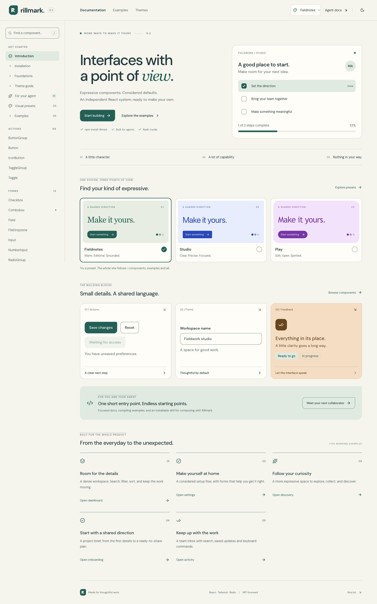

# Rillmark

**Interfaces with a point of view.** An independent React design system for people and their coding agents, with 48 original components, three coordinated visual presets and five complete examples.

**[Live documentation and examples](https://rillmark.vercel.app)** · **[npm 0.2.0](https://www.npmjs.com/package/rillmark)** · **[AI entry point](https://rillmark.vercel.app/llms.txt)** · **[Private repository](https://github.com/BereketAbera/rillmark)**



## Install

For a React 19 application:

```sh
npm install rillmark
```

Import the stylesheet once and the components you need:

```tsx
import 'rillmark/styles.css'
import { Button } from 'rillmark/button'

export function SaveAction() {
  return <Button onClick={() => console.log('Saved')}>Save changes</Button>
}
```

Root imports such as `import { Button, Field, Input } from 'rillmark'` also work. JavaScript modules and TypeScript declarations are included. The precompiled stylesheet supplies component styles, all three presets and light/dark/system appearance without requiring Tailwind setup. Use your own CSS for application layout.

In an existing Tailwind CSS 4 app, use these imports **instead of** `rillmark/styles.css`:

```css
@import "tailwindcss";
@import "rillmark/tailwind.css";
```

This registers component classes for scanning and provides semantic utilities. Set two root attributes to choose a preset and appearance; semantic CSS variables remain customizable. See [the package guide](packages/rillmark/README.md) and [complete setup](docs/guides/getting-started.md).

## What ships

| Family | Components |
| --- | --- |
| Actions | Button, IconButton, ButtonGroup, Toggle, ToggleGroup |
| Forms | Field, Input, Textarea, Checkbox, RadioGroup, Switch, Select, Combobox, Slider, NumberInput, TagInput, FileDropzone |
| Structure | Card, Separator, Tabs, Accordion, Breadcrumbs, Pagination, Collapsible, NavigationMenu, ScrollArea |
| Overlays | Dialog, AlertDialog, Sheet, Popover, Tooltip, DropdownMenu, ContextMenu, HoverCard, Command |
| Feedback/display | Alert, Toast, Badge, Avatar, Skeleton, Progress, Table, Meter, Spinner, Kbd |
| Patterns | EmptyState, Stepper, Timeline; complete searchable, validated and persistent workflows |

All 48 components have compiling examples, live previews, readable source and generated local API metadata. The documentation includes search, preset and appearance controls, mobile previews, and five working applications: a project dashboard, workspace settings, resource discovery, a multi-step project brief and a team activity inbox. Search, validation, review, filtering, read/saved states, draft persistence and export work locally. Selected files remain on the device; no backend is connected.

## A different feel in two settings

```html
<html data-rillmark-preset="studio" data-rillmark-mode="system">
```

| Preset | Character |
| --- | --- |
| `fieldnotes` (default) | Warm paper, mineral green, editorial accents, a signature corner |
| `studio` | Cool neutrals, clear blue, precise corners, quicker transitions |
| `play` | Soft violet, warm accents, generous curves, a gentler rhythm |

Appearance is independently `light`, `dark` or `system`. Both stylesheet paths include every preset. No provider or extra package is needed, and portalled overlays inherit automatically. The existing `.dark` class remains supported when no explicit mode overrides it.

Try the **[live preset explorer](https://rillmark.vercel.app/#/themes)** and read [the theme guide](docs/guides/themes.md) or [design-system research](docs/preset-research.md).

`tokens.json` is the canonical token source. It generates all six semantic palettes, shape, typography, motion and the package CSS. Components live in `packages/rillmark/src/`; the documentation and npm package use that same implementation. Radix supplies complex accessible interactions; ordinary controls use native HTML. There is no custom CLI, MCP server, configuration language, or theme engine.

## Start here, agents

Read [llms.txt](https://rillmark.vercel.app/llms.txt), follow setup, then fetch only the relevant component pages. Examples use the same imports that consumers install. API metadata comes from TypeScript implementation.

Install the consuming skill from your application directory:

```sh
npx skills add ./node_modules/rillmark --skill rillmark -a codex -a claude-code --copy -y
```

The skill covers npm setup, discovery, composition, customization and verification. See [the skill](skills/rillmark/SKILL.md), [AI setup](docs/guides/ai.md), and [installation verification](docs/skill-installation.md). No MCP configuration is required.

## Develop and verify

Use Node 24:

```sh
npm ci
npm run dev
```

Open [local documentation](http://localhost:5173). Sources are in `packages/rillmark/src/`, compiling examples in `examples/components/`, guides in `docs/guides/`, and tokens in `tokens.json`. Generated documentation and metadata are committed so CI can check for drift. Read [AGENTS.md](AGENTS.md) before contributing.

```sh
npm run check          # source/example consistency, token contrast, TS, ESLint, unit tests
npm run build          # static documentation in dist/
npm run package:build # JS, declarations, CSS and tokens from canonical source
npm run test:package  # packed tarball in a fresh app; headed interaction/style tests
npm run test:e2e      # headed Chrome: all components, a11y, mobile and complete workflows
```

CI runs these useful repeatable checks, using headed Chromium under Xvfb. See [verification](docs/verification.md) and [release instructions](docs/releasing.md).

## Hosting

The site is deployed at **[rillmark.vercel.app](https://rillmark.vercel.app)** in Vercel's `bereketaberas-projects` scope. Deployments use the local checkout; Git-triggered deployment is disabled. `npm run build` also produces a self-contained static site for another host.

Redeploy with `vercel deploy --prod --scope bereketaberas-projects`. A new checkout first runs `vercel link --yes --project rillmark --scope bereketaberas-projects`. Local project metadata stays in ignored `.vercel/`.

## Container image

The documentation also ships as a static nginx image for **rillmark.bereket.dev**, which the [plane-platform](https://github.com/BereketAbera/plane-platform) repository deploys. The Vercel deployment above stays until the owner retires it.

```sh
docker build -t rillmark-web:local .
docker run --rm --read-only --tmpfs /tmp -p 127.0.0.1:8088:8080 rillmark-web:local   # http://127.0.0.1:8088
scripts/smoke-image.sh rillmark-web:local
```

The build stage runs `npm ci` and `npm run build` on the builder's own platform and writes a `.gz` beside each text file of 1 KiB or more. The runtime stage only copies `dist/` and [`deploy/nginx/`](deploy/nginx/) onto `nginxinc/nginx-unprivileged`, which runs as uid 101 on port 8080 with only `/tmp` writable. Hashed files under `/assets/` are cached for a year, everything else revalidates, and a path with no file is a 404 because the site routes with the URL hash. `scripts/smoke-image.sh` runs an image that way on a random local port, checks status, content type, caching, security headers and gzip for the agent-facing files and the app, and always removes its container.

[`images.yml`](.github/workflows/images.yml) builds and smoke-tests `linux/amd64` on pull requests. On `main` it pushes `ghcr.io/bereketabera/rillmark/web:<first 12 characters of the commit>` for `linux/amd64` and `linux/arm64`, pulls the `linux/amd64` digest back to smoke-test it and scan it with trivy, and then records the index and `linux/amd64` digests in the run summary and an `image-digests` artifact.

## Release boundaries

This scoped release excludes spreadsheet grids, rich-text editing and complex charts. Chromium is verified; dedicated Safari/Firefox, real touch-device and screen-reader sessions remain unverified. Automated accessibility checks supplement keyboard and visual review; they do not establish complete conformance.

MIT licensed. The documentation bundles DM Sans under the included [SIL Open Font License](public/licenses/dm-sans-OFL.txt); package consumers can load the font separately or keep the system fallback.
